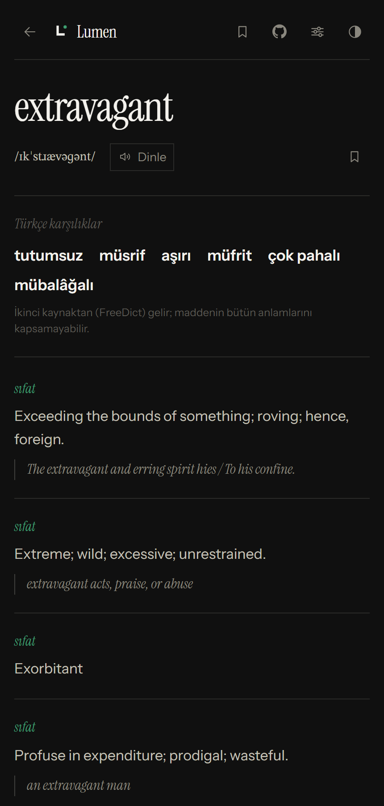
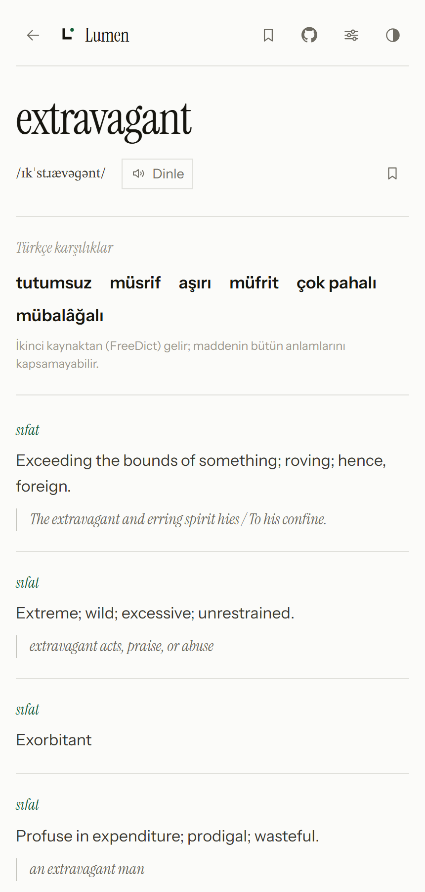

<p align="center">
  
</p>

<h1 align="center">Lumen</h1>

<p align="center">
  İki yönlü Türkçe–İngilizce sözlük.<br>
  Tarayıcıda çalışır, sunucu istemez, hesap istemez, veri cihazdan çıkmaz.
</p>

<p align="center">
  <a href="https://berkehazar.github.io/Lumen/"><b>Canlı sürüm →</b></a>
</p>

<p align="center">
  
  
  
  
</p>

<p align="center">
  
  
</p>

<p align="center">
  <sub>44.683 İngilizce · 34.734 Türkçe madde · 55 MB veri · sıfır bağımlılık</sub>
</p>

- **Ara → bul → oku → kapat.** Oyunlaştırma yok; streak, XP, seviye, rozet yok.
- **Çevrimdışı.** İlk açılıştan sonra ağ olmadan da çalışır.
- **Statik.** GitHub Pages'te barınır; backend, API anahtarı, veritabanı yok.
- **Sıfır build.** Vite, webpack, npm kurulumu yok. Depoyu düzenle, kaydet, yayına gir.

---

## Hızlı başlangıç

Depoyu klonla ve bir statik sunucu başlat. Dosya protokolüyle (`file://`)
açılmaz — ES modülleri ve service worker origin ister.

```bash
git clone <depo-url> lumen
cd lumen
python -m http.server 8777
```

`http://127.0.0.1:8777` adresini aç.

### Testler

```bash
# Arama katmanı — tarayıcı gerekmez
node tools/test-search.mjs

# Arayüz, telaffuz, geçmiş — gerçek Chromium gerekir
PLAYWRIGHT_PATH=/yol/node_modules/playwright/index.mjs node tools/test-ui.mjs
PLAYWRIGHT_PATH=/yol/node_modules/playwright/index.mjs node tools/test-speech.mjs
PLAYWRIGHT_PATH=/yol/node_modules/playwright/index.mjs node tools/test-recent.mjs
PLAYWRIGHT_PATH=/yol/node_modules/playwright/index.mjs node tools/test-edge.mjs

# Sözlük kapsamı — veri ölçümü, tarayıcı gerekmez
node tools/test-coverage.mjs

# ...aynı ölçüm + çekimli biçim davranışı (Chromium gerekir)
PLAYWRIGHT_PATH=/yol/node_modules/playwright/index.mjs node tools/test-coverage.mjs --ui

# Cihazda eski veri varken güncelleme görünüyor mu
PLAYWRIGHT_PATH=/yol/node_modules/playwright/index.mjs node tools/test-fresh.mjs
```

`test-edge.mjs` kapsamlı hata ayıklama turunda bulunan hataların regresyonudur:
vurgu kaçışı, yazım önerisi, geri düğmesi (fare ve klavye), geçmişi tümden
temizleme, service worker veri önbelleği, sekme başlığı. `test-coverage.mjs`
ise sözlüğün kapsamını eşiklere bağlar ve **iki katmanın ayrı kaldığını**
doğrular — ana veriye FreeDict alanı sızarsa test kırılır.

`test-fresh.mjs` ayrı bir derde çare: tarayıcıyı temiz açan her test yeşil
veriyordu, çünkü "yeni kelime gelmiyor" sorunu kodda değil **cihazdaki eski
kopyada** oluyordu. Bu test kullanıcının durumunu birebir kurar: veri iner,
IndexedDB'ye eski biçimde (etiketsiz) parça yazılır, sayfa yenilenir ve yeni
kelime yine bulunmalıdır.

Toplam **204 kontrol** geçer (arama 19, arayüz 21, telaffuz 9, geçmiş 11,
uç durumlar 66, tazelik 15, kapsam 63).

Tarayıcı testleri `http://127.0.0.1:8777` adresinde sunucu bekler. Playwright
projenin bağımlılığı değildir (sıfır-build kuralı); kurulu olduğu yeri
`PLAYWRIGHT_PATH` ile göster. Ekran görüntüleri `.shots/` altına yazılır.

---

## GitHub Pages'e yayınlama

```bash
git config --global user.name "Adın"
git config --global user.email "github-epostan"

git add .
git commit -m "Lumen: iki dilli sözlük, çevrimdışı çalışır"
git remote add origin https://github.com/<kullanıcı>/<depo>.git
git branch -M main
git push -u origin main
```

Sonra **Settings → Pages → Build and deployment → Source: GitHub Actions**.
Başka ayar gerekmez; iş akışı yayını kendisi yapar.

1. `main` dalına her itişte `.github/workflows/deploy.yml` çalışır: sözlük
   verisini Kaikki.org'dan yeniden üretir, testleri koşar, siteyi yayınlar.
   Ayrıca her ayın 1'inde zamanlanmış olarak veriyi tazeler.
2. İlk çalışma 5–10 dakika sürer (523 MB arşiv indirilir).
3. Adres: `https://<kullanıcı>.github.io/<depo>/`

**Yayın paketi.** İş akışı `dist/` klasörüne yalnızca çalışma zamanı
dosyalarını kopyalar (`index.html`, `sw.js`, `css/`, `js/`, `vendor/`,
`icons/`, `data/`). Önceden `path: .` veriliyordu; bu `.git` dizinini ve
`tools/` altındaki geliştirme araçlarını da pakete koyuyordu.

**Alt klasör uyumu.** Tüm yollar göreli (`./sw.js`, `import.meta.url`).
Site `kullanıcı.github.io/depo/` altında yayınlandığında da çalışır.

**Lisanslar.** Yayınlanan site iki lisanslı veri taşır: `data/en-tr/` ve
`data/tr-en/` **CC BY-SA 4.0**, `data/freedict/` **GPL-2.0+** (kendi `LICENSE`
dosyasıyla). İkisi ayrı dosyalarda durur; iş akışı `data/freedict/LICENSE`
eksikse yayını durdurur.

**Güvenlik ağı.** Veri üretimi başarısız olursa (Kaikki.org çökmüş, ağ sorunu,
biçim değişmiş) iş akışı durmaz; repodaki önceki veri kullanılır ve site yine
yayınlanır. Site hiçbir koşulda boş açılmaz. İkinci katman için de aynısı
geçerli.

---

## Dosya düzeni

```
index.html               tek sayfa kabuğu; tema ilk boyamadan önce uygulanır
manifest.webmanifest     PWA bildirimi
sw.js                    service worker (stale-while-revalidate)
css/stage.css            tüm stiller — tek dosya
js/app.js                yönlendirme, görünümler, olaylar
js/icons.js              elle çizilmiş ikon seti + marka işareti
js/store.js              IndexedDB: ayarlar, favoriler, sözlük ve ses önbelleği
js/dict.js               parçalı veri yükleme + madde birleştirme
js/search.js             MiniSearch sarmalayıcısı + Türkçe harf katlaması
js/speech.js             telaffuz: Wikimedia kaydı → tarayıcı sesi → hata
vendor/                  gömülü kütüphaneler (offline ilk açılış CDN'e bağlı olamaz)
data/                    üretilmiş sözlük verisi
tools/                   veri üretimi, testler, doğrulama betikleri
icons/                   PWA ikonları
docs/                    README görselleri (ekran görüntüleri)
```

### Kütüphaneler neden gömülü

`vendor/` altındaki MiniSearch, idb-keyval ve wiktionary-sound CDN'den
çekilmez. Uygulama çevrimdışı çalışmayı vaat ediyor; ilk açılışın üçüncü bir
sunucuya bağlı olması bu vaadi bozar.

Lucide paket olarak eklenmedi (tree-shaking olmadan ~600 KB). Yerine gereken
ikonlar `js/icons.js` içine satır içi SVG olarak çizildi.

---

## Veri

Sözlük **iki ayrı kaynaktan** beslenir ve bu ikisi bilinçli olarak ayrı tutulur.

### Katman 1 — Wiktionary (omurga)

Kaynak: [Kaikki.org](https://kaikki.org) — Wiktionary'nin ayrıştırılmış hâli.
Lisans **CC BY-SA 4.0**; uygulamada atıf zorunlu, **Ayarlar → Hakkında**
bölümünde yer alır.

| | Ham kaynak | Üretilen |
| --- | --- | --- |
| İngilizce | 3,34 GB JSONL (523 MB gz) | 44.683 madde |
| Türkçe | 437 MB JSONL (33,5 MB gz) | 34.734 madde |

### Katman 2 — FreeDict eng-tur (boşluk dolgusu)

Wiktionary'nin İngilizce maddelerinde Türkçe çeviri çoğu zaman **yok**
(`extravagant`, `explicit`, `exotic`, `exquisite` — ham vikimetinle doğrulandı).
FreeDict bu boşluğu doldurur: 30.239 kelime, 1,8 MB.

Lisansı **GPL-2.0+**; bu yüzden **ayrı dosyalarda** durur (`data/freedict/`) ve
hiçbir dosya iki kaynağı birden içermez. Uygulama ikisini yalnızca çalışma
anında, bellekte birleştirir — birleşik hâli diske yazılmaz. GPLv2 §2'deki
*mere aggregation* hükmü tam olarak bunu kapsar:

> *"mere aggregation of another work not based on the Program with the Program
> ... on a volume of a storage or distribution medium does not bring the other
> work under the scope of this License."*

Kural: **Wiktionary kazanır.** Bir madde kendi Türkçe karşılığını taşıyorsa
FreeDict ona hiç dokunmaz. FreeDict çevirilerinin anlam etiketi yoktur;
var olan bir maddenin altına dizilirlerse yanlış tanımın altına düşerler.
Bu yüzden ayrı ve başlıklı bir blok olarak gösterilirler ("Türkçe karşılıklar").

Ayrıntı ve atıf: [`data/freedict/README.md`](data/freedict/README.md)

Toplam 57 MB, harfe göre parçalı. Tarayıcı yalnızca aradığın harfin dosyasını
indirir, IndexedDB'ye yazar, bir daha inmez.

### Kapsam — ve neden bu kadar küçük

Sözlüğün sınırı **kaynağın kendisidir**, derleme betiğinin değil. Ölçüm:
Kaikki'nin İngilizce dosyasında **1.492.836** kayıt var, bunların yalnızca
**27.050**'inde bir Türkçe karşılık bulunuyor (%1,8). Wiktionary'nin İngilizce
maddelerinde Türkçe çeviri tablosu çoğu zaman yok — ham vikimetin doğrulaması:
`extreme` yalnızca **Osmanlıca** çeviri taşıyor (`{{t|ota|…}}`), `exotic`
kaydında `{{t-needed|tr}}` yani "çeviri gerekli" şablonu var, `extravagant`
maddesinde Türkçe bölümü hiç yok. Bunlar uydurulamaz.

Sıklık listesine göre kapsam (ilk N en sık İngilizce kelime):

| | Başlangıç | Şimdi |
| --- | --- | --- |
| ilk 500 | %74,0 | **%91,4** |
| ilk 1.000 | %70,9 | **%93,8** |
| ilk 3.000 | %59,1 | **%90,4** |
| ilk 10.000 | %44,0 | **%81,4** |

Kapsamı `tools/test-coverage.mjs` ölçer ve eşiklerin altına düşerse testi
kırar. Ölçüm yapılmadan bu sorun görünmez — nitekim görünmedi.

### C1–C2 dağarcığı

Sıklık listesi günlük dili ölçer; `meticulous`, `ubiquitous` gibi kelimeler ilk
10.000'de yoktur. İleri seviye bir kelimeyi arayan kişi onu bulamazsa sözlük
işe yaramaz. Bu yüzden ayrı bir ölçüm var: CEFR C1–C2 listesinden seçilmiş
**50 kelime**, hem veri katmanında hem gerçek arayüzde açılarak denetlendi.

| | Sonuç |
| --- | --- |
| madde var | **49/50** |
| Türkçe karşılıklı | **49/50** |
| kaynak dağılımı | 35 Wiktionary, 14 FreeDict |
| eksik | `eloquent` |

`eloquent` gerçek bir kaynak boşluğu: en.wiktionary maddesinde Türkçe satırı
yalnızca **Osmanlıca** karşılık taşıyor (`{{t|ota|فصیح|tr=fasih}}`), FreeDict'te
ise bağımsız madde yok — kelime yalnızca `eloquence` maddesinin içinde geçiyor.
`extreme` ile aynı sınıf. Uydurulmaz.

**Ama 6 kelimede anlam eşleşmesi tutmuyor.** `articulate` → "mafsal ile
birleştirmek", `coherent` → "yapışık", `pragmatic` → "(fels.) pragmatizme ait",
`ephemeral` → "efemera", `intricate` → "ince işçilik", `paramount` → "ulu, yüce".
Hepsi doğru çeviri ama **yanlış anlam** — C1 anlamı (akıcı konuşan, tutarlı,
yararcı, kısa ömürlü, girift, en önemli) karşılıksız kalmış. Sebep kaynakta:
FreeDict'in çevirilerinde ne tür ne anlam etiketi var, Wiktionary'de ise o
anlamların Türkçesi hiç yok.

Bu yüzden madde düzeyindeki karşılıklar **kaynağıyla birlikte** gösterilir:
tanımlar da varsa blok altına "İkinci kaynaktan (FreeDict) gelir; maddenin
bütün anlamlarını kapsamayabilir." notu düşülür. Not olmadan bu, sözlüğün
hatası gibi görünüyordu.

Kalan eksiklerin çoğu **aranmayacak** kelimeler: işlev sözcükleri (`the`, `us`,
`could`), tek harfli kısaltmalar (`pm`, `x`, `n`) ve özel adlar (`ebay`,
`uk`). İlk 500'de eksik kalan 54 kelimeden yalnızca 15'i içerik kelimesi.

Orta sıklıkta kalan boşluklar (`extravagant`, `explicit`, `exotic`,
`exquisite`) bu kaynaktan **kapatılamaz** — Wiktionary'nin o maddelerinde
Türkçe bölümü hiç yok. Bu durumda uygulama boş ekranda bırakmaz: madde
bulunamadığında Wiktionary ve Tureng bağlantıları sunulur.

### Değerlendirilip alınmayan kaynaklar

Aynı lisanslı (CC BY-SA) bir kaynak arandı ve bulunamadı:

| Kaynak | Lisans | `extravagant`? |
| --- | --- | --- |
| tr.wiktionary (tam döküm ayrıştırıldı: 1,28 GB, 319.059 madde) | CC BY-SA 4.0 | ✗ |
| Wikidata lexeme `L336655` | CC0 | ✗ |
| MUSE en-tr (58.901 çift) | CC BY-NC 4.0 | ✓ ama gevşek: `abartılı` |
| FreeDict eng-tur | GPL-2.0+ | ✓ ve iyi: `tutumsuz/müsrif/aşırı` |

tr.wiktionary'nin `====Çeviriler====` bölümleri var (`* İngilizce: {{ç|en|water}}`)
ve lisansı bizimle aynı — ama tüm dökümde yalnızca **22.662** İngilizce çeviri
satırı bulunuyor ve aradığımız kelimelerin hiçbiri yok. MUSE'ın lisansı
ticari kullanımı yasaklıyor ve çevirileri gevşek. Geriye FreeDict kaldı.

### İki çeviri kaynağı

Wiktionary çevirileri iki ayrı yerde tutar ve **ikisi de okunmalı**:

1. `sense.translations` — anlamın kendi içindeki çeviri (asıl kaynak)
2. `entry.translations` — maddenin üstündeki toplu çeviri tablosu

İkincisi uzun süre okunmuyordu ve ölçülebilir kayıp yaratıyordu: `cat` (kedi),
`dictionary` (sözlük), `new`, `make`, `system`, `policy`, `movie`, `natural`
gibi kelimelerin kaydında Türkçe çeviri **yalnızca** üst düzey tabloda duruyor.
Bu alan okunmaya başlayınca **+1.522 kelime** geldi.

Üst düzey tablodaki her çevirinin yanında kısa bir `sense` etiketi olur
(`"unit of language"`). Etiket bir anlamın tanımıyla örtüşüyorsa çeviri **o**
anlama eklenir; örtüşmüyorsa etiket tanım yerine geçip yeni anlam açılır.
Böylece "her anlam kendi tanımını ve çevirisini taşır" kuralı korunur —
çeviriler ilk anlama yığılmaz.

### Çekimli biçimler

Wiktionary madde başlarını (lemma) taşır; çekimli biçimlerin çoğu çevirisizdir.
Arama bulunamayınca gövdeye düşülür: `books→book`, `systems→system`,
`prices→price`, `using→use`. Ölçüm: ilk 10.000 sıklıkta eksik olan 5.175
kelimenin 2.157'si çekimli biçim; bu adım kapsamı %48,3'ten **%69,8**'e
çıkarıyor.

Arayüz bunu **söyler** ("books çekimli biçim — book maddesi gösteriliyor"),
çünkü aksi hâlde çekimli biçimin kendi maddesi varmış gibi görünür.

Düzensiz biçimler (`made`, `children`, `women`, `went`) ek soymayla
çözülemez; bunlar için kaynakta `senses[].form_of` alanı var ve istenirse
derleme sırasında bir biçim→lemma haritası üretilebilir (ölçüm: 131.398 kayıt,
~780 KB gzip, ilk 500'de +5 kelime). Şu an **dahil değil** — getirisi
maliyetine göre düşük bulundu.

### Veriyi yeniden üretmek

```bash
# Önce ikinci katman: build-dict onun başlık listesini okur
node tools/build-freedict.mjs                     # FreeDict (GPL) — ~10 sn

node tools/build-dict.mjs --dir both              # tam derleme (~50 sn)
node tools/build-dict.mjs --dir en --limit 5000   # hızlı deneme
node tools/build-dict.mjs --dir both --out dist/data
```

**Sıra önemli:** `build-dict.mjs`, Türkçesi olmayan bir kaydı tutup tutmayacağına
`data/freedict/` başlık listesine bakarak karar verir. Katman yoksa o kayıtlar
tümüyle düşer ve kapsam %69,8'e geriler.

Betik 3,34 GB'lık dosyayı satır satır akış hâlinde okur — belleğe almaz —
yalnızca Türkçe karşılığı olan kayıtları tutar.

### Veri modeli — kritik kural

**Türkçe çeviriler her anlamın KENDİ içinde durur** (`sense.translations`).
Çevirileri düzleştirip maddenin ilk anlamına yığmak, tanım ile karşılığı
koparır ve sessizce yanlış sözlük üretir — uygulama çalışıyor görünürken.

`buildSenses()` her anlamı kendi tanımı + kendi çevirisi + kendi örneğiyle
üretir. Çevirisi olan anlamlar listenin başına alınır. Aynı tanım iki kez
geçerse (farklı kökenler) eleme değil **birleştirme** yapılır. `invert()`
(TR→EN) de aynı kurala uyar.

Doğruluğu değiştirdikten sonra kaynak yapıyı incele:

```bash
node tools/inspect-word.mjs mature
```

### Örnek cümleler

Örnek cümlelerin Türkçe çevirisi kaynakta yok — uydurulmaz. Türkçe çeviri
varsa gösterilir, yoksa İngilizce örnek tek başına sunulur.

---

## Telaffuz

Sıralı üç adım; **sessiz yedek yok** — bir yöntem çalışmazsa kullanıcıya ne
olduğu anlaşılır dille söylenir.

1. **Wikimedia ses kaydı.** Maddenin kendi taşıdığı adresler önce denenir
   (ağ turu gerekmez); yoksa Wiktionary üzerinden aranır. Amerikan aksanı
   tercih edilir, toplu (LL-Q) kayıtlar elenir. Bulunan adres IndexedDB'ye
   yazılır — Wikimedia hız sınırı koyuyor, her tıklamada iki ağ turu olmasın.
2. **Tarayıcı konuşma sentezi.** Ses paketi kurulu değilse bu da bildirilir.
3. **Hata.** Kırmızı bildirim: ne olduğu, "Tekrar dene", "Harici sözlükte aç".

`wiktionary-sound` yalnızca dosya bulucu olarak kullanılır. Paketin kendi
önbelleği çalışmıyor, olmayan kelimede ham `TypeError` fırlatıyor ve ogg'a
puan veriyor — üçü de burada düzeltildi (`js/speech.js` başındaki nota bak).

---

## Tasarım

Yön: **Stage** — Instrument Serif (başlık), Instrument Sans (arayüz),
STIX Two Text (yalnızca fonetik).

- **Radius 0.** Gölge yok; katman ayrımı hairline çizgiyle yapılır.
- **Tek vurgu rengi:** yeşil `#3E9E70`.
- **Monospace yok.** Fonetik IPA serif bir aileyle dizilir.
- Fonetik için ayrı aile kullanılmasının nedeni: Instrument Serif ve
  Instrument Sans, IPA karakterlerinin yalnızca **%15'ini** içeriyor
  (`ɪ ɔ ː ɹ ʃ ˈ` yok). Bir fontu fonetik için seçmeden önce gerçek cmap
  tablosu doğrulanır — `unicode-range` beyanı glif varlığını garanti etmez.

```bash
pip install fonttools brotli
python tools/check-fonts.py "Instrument Sans" "STIX Two Text"
```

Yeni ikon gerekiyorsa `tools/make-icons.py` ile PWA ikonları aynı geometriden
yeniden üretilir.

### Üst çubuk

`[geri] Lumen  EN⇄TR …  favoriler  GitHub  ayarlar  tema`

- **Marka tıklanabilir** (`data-act="home"`). Aramada sayfa yeniden çizilmez,
  yalnızca arama alanına odaklanır — boşuna bir gezinme adımı "geri" düğmesini
  kirletmesin diye.
- **Yön düğmesi yalnızca arama ekranında.** Ayarlarda ve favorilerde karşılığı
  olmayan bir denetim; yer kaplamaktan başka iş yapmıyordu.
- **GitHub düğmesi favorilerin sağında.** Tek dolu ikon: marka işaretleri
  çizgiye indirgendiğinde tanınmıyor. Bu yüzden 16 px — optik ağırlığı
  1.4 px'lik çizgi ikonlarla dengelensin diye.
- **Daralma sırası ölçülerek seçildi** (360/390/320 px): önce boşluklar
  (14→8→6), sonra ikon kutusu (34→32), en son "Lumen" yazısı gizlenir.
  İkonlar **asla sıkışmaz** — `flex: 0 0 auto` olmadan 34 px'lik hedef dar
  ekranda 19 px'e düşüyordu, yani dokunulamaz hâle geliyordu.

---

## Kısayollar

| Tuş | İşlev |
| --- | --- |
| `/` veya `Ctrl/⌘ + K` | Aramaya odaklan |
| `↑` `↓` | Sonuçlar arasında gez |
| `Enter` | Seçili sonucu aç |
| `Esc` | Alanı temizle / geri dön |

---

## Tuzaklar

Bu projede birebir yaşanmış, tekrar düşmemek için not edilmiş noktalar:

- **`node --check` yetmiyor.** `async` olmayan bir işleyicide `await`
  kullanımını yakalamaz; tarayıcıda "Unexpected reserved word" olarak patlar ve
  uygulama hiç açılmaz. Değişiklikten sonra `tools/test-ui.mjs` koşulur.
- **idb-keyval aynı veritabanında ikinci store açamaz.** `createStore(db, s)`
  yalnızca ilk çağrıda store yaratır. Her katman ayrı veritabanı alır:
  `lumen-settings`, `lumen-favorites`, `lumen-dict`, `lumen-audio`.
- **MiniSearch `id` alanı ister.** `idField: 'w'` ayarlanmazsa `addAll` hata verir.
- **`/[ſƿǽ]/i` tuzağı.** Harf duyarsız bayrakla `ſ` (U+017F) normal "s" ile
  eşleşir. Karakter sınıfı ayrı ve bayraksız çalıştırılır.
- **Service worker sürümü.** Stale-while-revalidate kullanıldığı için kabuk
  dosyaları (html/css/js) değişince `sw.js` içindeki `VERSION` artırılmazsa
  kullanıcı bir tur eski arayüzü görür.
- **Kaçırılmış dizeyi indeksle dilimleme.** Arama sonucunda eşleşen parçayı
  işaretlerken indeks HAM kelime üzerinde hesaplanır. Dilimleme kaçırılmış dize
  üzerinde yapılırsa indeksler kayar — `esc()` tek karakteri birden fazlasına
  çevirebilir (`'` → `&#39;`). Belirti: madde başlığı ekranda bozulur.
  Doğrusu: indekse göre ham dizeyi dilimle, kaçışı her parçaya ayrı uygula.
- **`history.length` geri düğmesi için yanlış ölçüt.** Paylaşılan bir kelime
  bağlantısıyla doğrudan giren kullanıcının tarayıcı geçmişinde uygulamaya ait
  adım yoktur ama `history.length` yine de > 1 olur; `history.back()` kullanıcıyı
  uygulamadan çıkarır. Uygulama içi gezinme derinliği ayrıca sayılır.
- **Sözlük verisi iki katmanda önbelleklenir.** IndexedDB (uygulama) ve service
  worker'ın HTTP önbelleği. Önbellek temizliği ikisini birden boşaltmazsa
  kullanıcı yeri boşaltamaz — `sw.js`'e `clear-data-cache` mesajı gönderilir.
- **Playwright'ta `page.goto` aynı adrese gitmek sayfayı yeniden yüklemez.**
  Temiz bir açılış gereken testte `page.reload()` kullanılmalı; aksi hâlde
  uygulamanın bellekteki durumu korunur ve test yanlış sonuç verir.
- **Çeviriler yalnızca `sense.translations`'ta değil.** `entry.translations`
  (üst düzey toplu tablo) da okunmalı — okunmadığında `cat`, `dictionary`,
  `new`, `make` gibi kelimeler sessizce düşer. Ölçüm: +1.522 kelime.
- **"Kelime yok" şikâyeti tek tek maddelere bakarak doğrulanamaz.** Ölçüt,
  sık kullanılan kelimelerin ne kadarının sözlükte olduğudur. Kapsam ölçümü
  (`tools/test-coverage.mjs`) yapılmadan bu sorun görünmez — nitekim görünmedi.
- **Önbellek adları sürümlenir.** `lumen-shell-v10`, `lumen-data-v3`. Veri
  şeması değişince `DATA_VERSION` artırılmazsa eski parçalar sessizce servis
  edilmeye devam eder; her kabuk güncellemesinde artırılırsa 55 MB boşuna
  yeniden iner.
- **IndexedDB parçaları ETİKETLİ saklanır — asıl tuzak buydu.** Parçalar
  `${dir}/${harf}` anahtarıyla duruyordu, yani sürümsüzdü. Veri yeniden
  derlendiğinde uygulama ağa hiç gitmiyor, cihazdaki eski kopyayı okuyordu;
  yeni kelimeler **hiçbir zaman** görünmüyordu ve her test yeşil veriyordu
  (testler temiz tarayıcı açtığı için). Artık anahtar `d<manifest.generated>`
  etiketini taşır: veri tazelenince anahtar değişir, eski kayıt okunmaz ve
  arka planda silinir. `tools/test-fresh.mjs` bunu kilitler.
- **Manifest ve parçalar aynı eski nesilden gelirse etiket hiç değişmez.**
  Bu yüzden `cache: 'no-cache'` taşıyan veri istekleri service worker'da
  ağ-önce yapılır (`fresh()`), diğerleri stale-while-revalidate kalır.
  Koşullu istek sayesinde değişmemiş dosya için yalnızca 304 döner, gövde
  yeniden inmez.
- **Güncelleme sonrası yenileme `index.html`'de yapılır, `app.js`'te değil.**
  `app.js` de önbellekten eski sürümüyle gelebilir; `index.html` ise her
  gezinmede ağdan geldiği için her zaman günceldir. Satır içi betik yeni
  service worker devreye girince sayfayı bir kez yeniler.
- **Türkçesiz kayıt alırken harf büyüklüğü şartı.** FreeDict'te karşılığı olan
  bir kelimenin Wiktionary kaydı Türkçesizse tutulur — ama yalnızca kelime
  tamamen küçük harfse. Aksi hâlde `"Water"` (yer adı) gibi özel ad kayıtları
  da gelir (çünkü `"water".toLowerCase()` FreeDict'te vardır) ve `"water"`
  maddesinin yanına düşüp onu gölgeler. Ölçüm: bu koşul olmadan 5.948
  yinelenen kayıt oluşuyordu.
- **Hash yönlendirmesinde kaydırma konumu korunur.** Uzun bir maddeden (ör.
  "water", ~3000 px) ayarlara geçen kullanıcı sayfayı ortadan açıyordu —
  ölçüm: 900 px kaydırmadan sonra ayarlar 352 px'te. Rota değişince
  `window.scrollTo(0, 0)` çağrılır; **aynı rotada** yeniden çizimde (tema,
  favori) konum korunur.
- **`flex` öğeleri sessizce sıkışır.** Başlığa dördüncü ikon eklenince 320 px'te
  `.ibtn` 34 px'ten 19 px'e indi: dokunma hedefi kayboldu, taşma da vardı.
  `flex: 0 0 auto` + ölçülmüş daralma sırası gerekir; varsayılan davranış
  "sığdırmak" için küçültmektir.
- **GPL'li veriyi ayrı dosyada tut.** FreeDict (GPL-2.0+) ile Wiktionary
  (CC BY-SA 4.0) tek dosyada birleştirilirse lisanslar uyumsuz olur. Ayrı
  dosyalar + çalışma anında birleştirme = GPLv2 §2 "mere aggregation".
  `test-coverage.mjs` ana veride `wtr` alanı sızıntısı olmadığını doğrular.
- **FreeDict çevirisinin ANLAM ETİKETİ yok — bunu kullanıcıya söyle.** Kaynak
  yalnızca tür/teknik anlamları içerebiliyor: `articulate` → "mafsal ile
  birleştirmek" (sıfatın C1 anlamı yok). Çeviriler yanlış değil, eksik; ama
  not düşülmezse sözlüğün hatası gibi görünüyor. Blok altındaki `.srcnote`
  yalnızca maddenin Wiktionary tanımları da varsa gösterilir — saf FreeDict
  maddelerinde çelişecek bir tanım yoktur.

---

## Lisans ve atıf

| Kapsam | Lisans |
| --- | --- |
| Uygulama kodu (`js/`, `css/`, `index.html`, `tools/`) | **MIT** — bkz. [LICENSE](LICENSE) |
| `data/en-tr/`, `data/tr-en/` | **CC BY-SA 4.0** (Wiktionary'den türetilmiştir) |
| `data/freedict/` | **GPL-2.0+** — kendi `LICENSE` ve `README.md` dosyasıyla |

Üçü ayrı eser olarak dağıtılır; hiçbir dosya ikisini birden içermez (GPLv2 §2
"mere aggregation"). Ses kayıtları Wikimedia Commons'tan gelir.

Uygulamayı çatallarsan atıf satırını koru — CC BY-SA 4.0 bunu zorunlu kılıyor.
